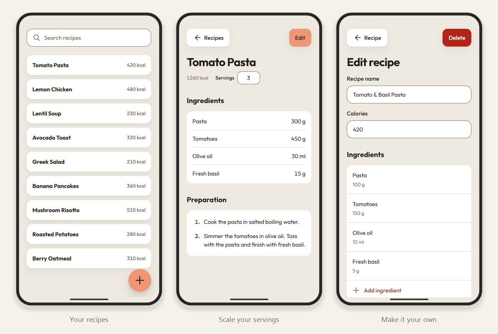

<div align="center">
  <h1>Portion</h1>
  <p>Your recipes at hand. Your portions just right.</p>

  
</div>

---

## Write it once. Cook for any number.

- **Your own recipe book.** Keep ingredients, preparation steps, and calories together.
- **Measurements that scale.** Change the servings to adjust ingredient amounts and calories automatically.
- **Ready offline.** Once offline setup finishes on your first visit, access your recipes without an internet connection.

## Get cooking

1. [Open the app](https://oxitorenk.github.io/portion/) and tap **+** to add your first recipe.
2. Enter ingredient amounts and calories **for one serving**, add the preparation steps, and save.
3. Open the recipe and enter how many servings you want. Your measurements are ready.

To use Portion like an app on your phone, choose **Share → Add to Home Screen** in Safari, or **Install / Add to Home Screen** from the menu in other supported browsers.

> **Your recipes stay in this browser.** They do not sync across devices. Clearing the browser’s site data deletes your recipes; export and backup are not currently available.

<details>
<summary><strong>Run locally</strong></summary>

With Node.js 24 and npm:

```sh
npm ci
npm run dev
```

Open the local URL shown in your terminal. To run checks and create a production build:

```sh
npm test
npm run build
```

Built with Svelte, TypeScript, and Vite. Recipes are stored in IndexedDB through Dexie; offline support is provided by a PWA service worker.

</details>
